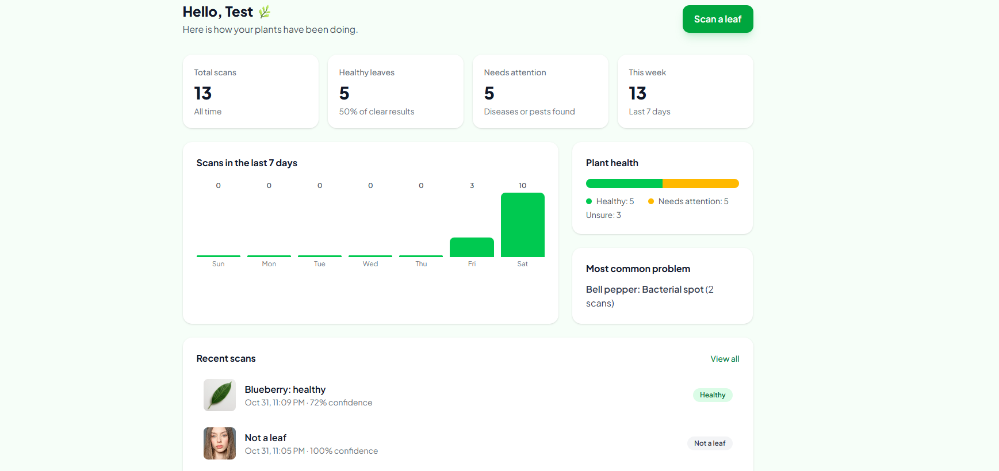
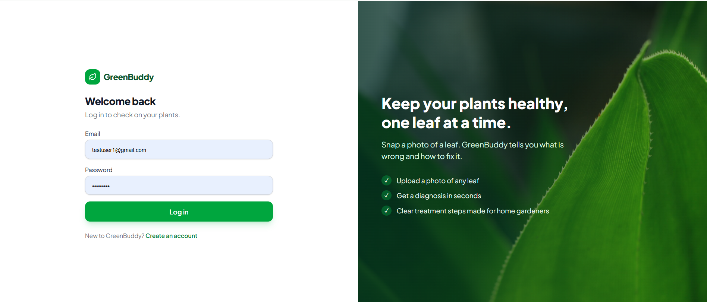
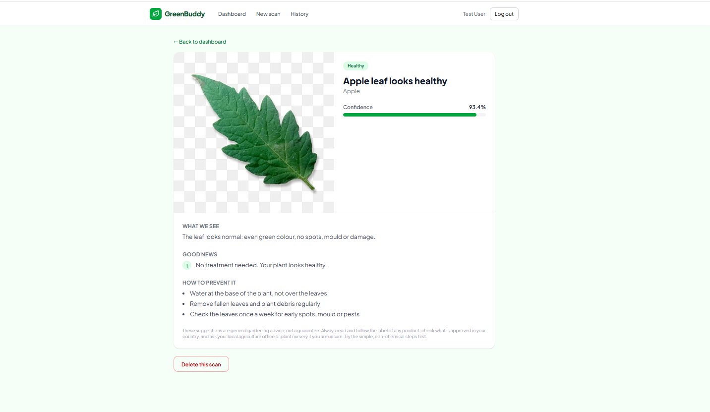
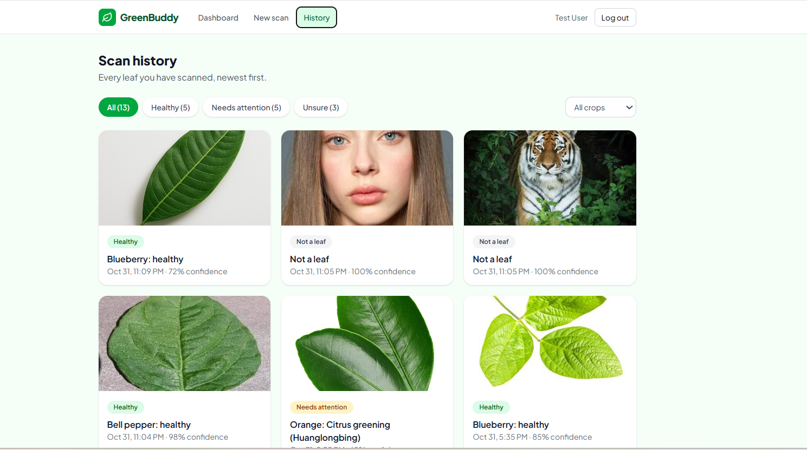
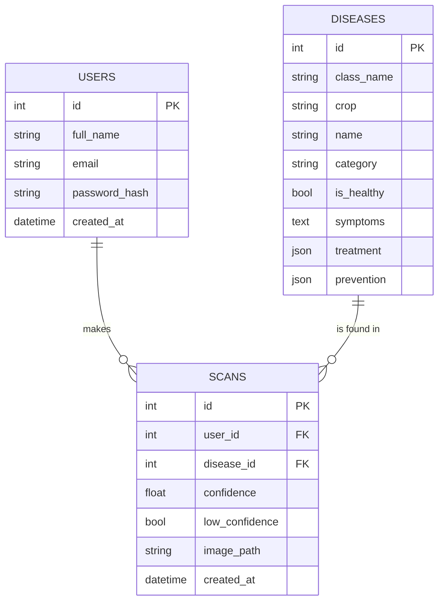

# GreenBuddy: AI Plant Doctor 🌿

A web app for home gardeners. Upload a photo of a leaf, and GreenBuddy tells you
what is wrong with it and how to treat it, using a CNN trained on 38 crop and disease types.



## Features

- Upload a leaf photo and get a diagnosis, treatment steps and prevention tips
- Honest results: says "not sure" when confidence is low, and "not a leaf" for other photos
- Accounts with secure login (hashed passwords, token-based authentication)
- Dashboard with your statistics, a 7-day activity chart and recent scans
- Scan history with filters, scan detail pages and delete

| Login | Result | History |
|---|---|---|
|  |  |  |

## How it works

```
React app  →  FastAPI backend  →  CNN model (MobileNetV2)
                    ↓
              SQLite database
```

## Tech stack

- **Frontend:** React, Vite, Tailwind CSS, React Router
- **Backend:** Python, FastAPI, SQLAlchemy, JWT authentication, bcrypt
- **Model:** TensorFlow / Keras, MobileNetV2 with transfer learning
- **Database:** SQLite (users, diseases, scans)

## The model

- **Training data:** the PlantVillage dataset (38 classes across 14 crops), plus 6,000 photos of
  everyday things (from Imagenette and Caltech-101) for an extra "not a leaf" class
- **Method:** MobileNetV2 pretrained on ImageNet, trained in two stages (new top layer, then
  fine-tuning the last 30 layers), with image augmentation
- **Results:**

| Test | Result |
|---|---|
| Leaf photos (38 classes), clean test set | 95.6% accuracy |
| Non-leaf photos, test set | 100% recognised |
| 11 of my own real-world photos | [write what you found, for example: no real leaf was rejected, uncertain ones were flagged] |

### Limitations

- The training photos are mostly leaves on plain backgrounds, so accuracy on real garden photos
  is lower than the test score. The app flags low-confidence results instead of guessing.
- It only knows 14 crops: apple, blueberry, cherry, corn, grape, orange, peach, bell pepper,
  potato, raspberry, soybean, squash, strawberry and tomato. Other plants (such as chilli or
  brinjal) are not supported yet.
- Treatment advice is general guidance, not professional agronomic advice.

## Database



## Run it locally

You need Python 3.10+ and Node.js 20+.

**Backend**

```
cd backend
python -m venv venv
venv\Scripts\activate
pip install -r requirements.txt
copy .env.example .env
```

Open `.env` and replace the secret with a random one:
`python -c "import secrets; print(secrets.token_hex(32))"`

```
python create_tables.py
python seed_diseases.py
uvicorn main:app --reload
```

**Frontend** (in a second terminal)

```
cd frontend
npm install
npm run dev
```

Open http://localhost:5173. The API docs are at http://127.0.0.1:8000/docs.

## API overview

| Method | Endpoint | What it does |
|---|---|---|
| POST | `/auth/register`, `/auth/login` | Create an account, log in |
| GET | `/auth/me` | Who is logged in |
| POST | `/predict` | Upload a leaf photo and get a diagnosis (login required) |
| GET | `/scans`, `/scans/{id}` | Your scan history and one scan |
| DELETE | `/scans/{id}` | Delete one of your scans |
| GET | `/stats` | Your dashboard statistics |

## Roadmap

- "My plants": follow one plant's scans over time
- Support for more crops, including common Sri Lankan ones
- Sinhala and Tamil versions
- Online deployment

## Credits and disclaimer

- Leaf images: the PlantVillage dataset (Hughes and Salathé, 2015). [check the licence on the
  dataset page and credit it as it asks]
- Non-leaf images: Imagenette (fast.ai) and Caltech-101
- GreenBuddy gives general guidance only. Always follow product labels and local regulations.